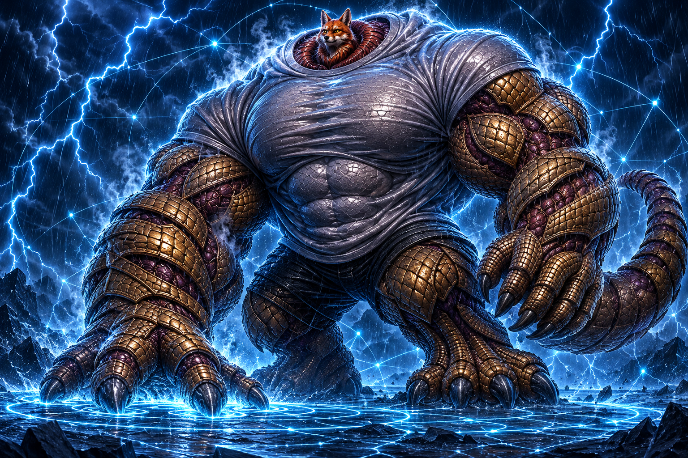
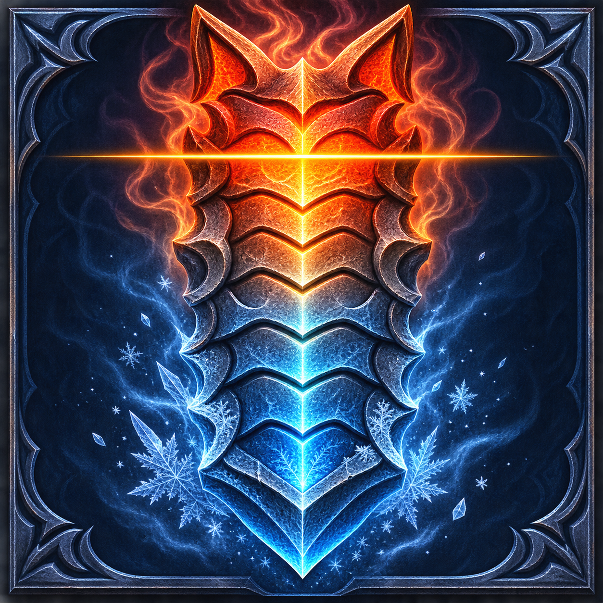
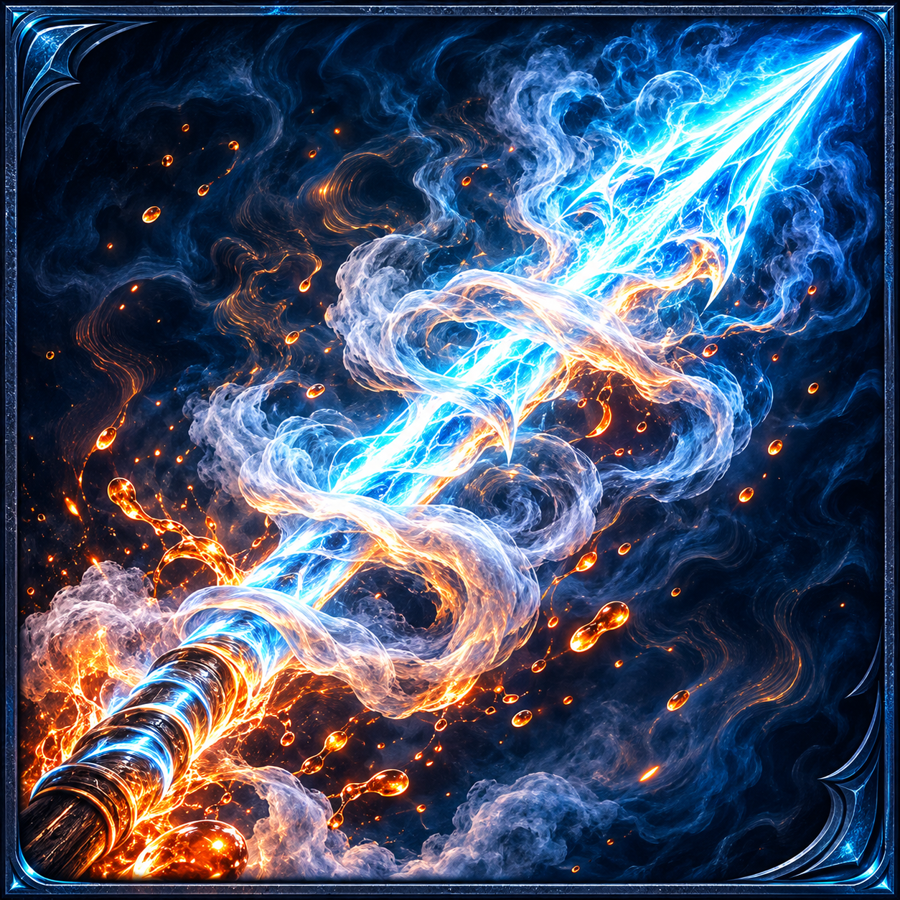
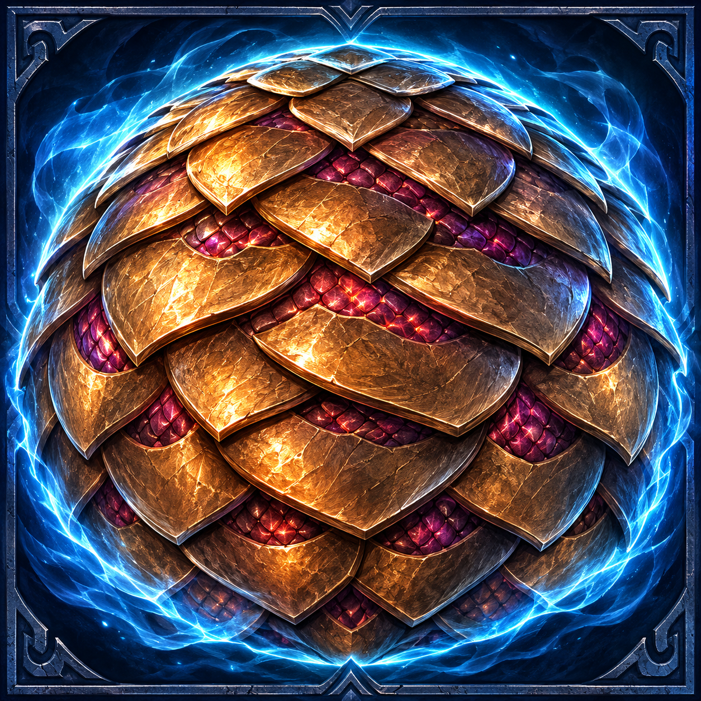
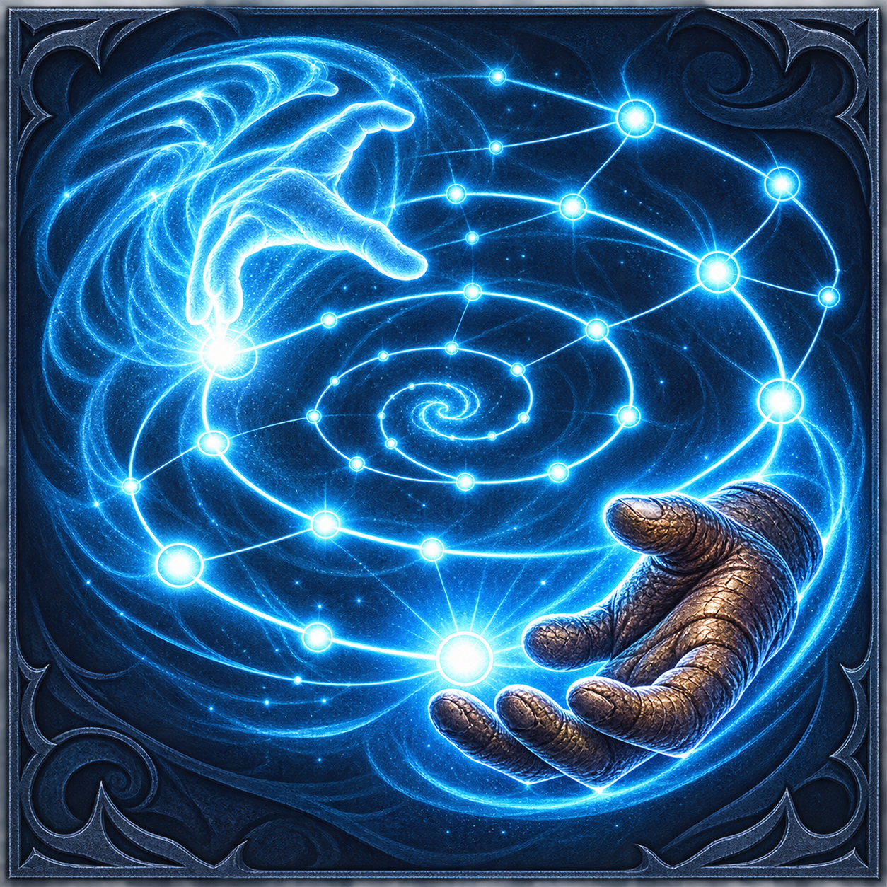
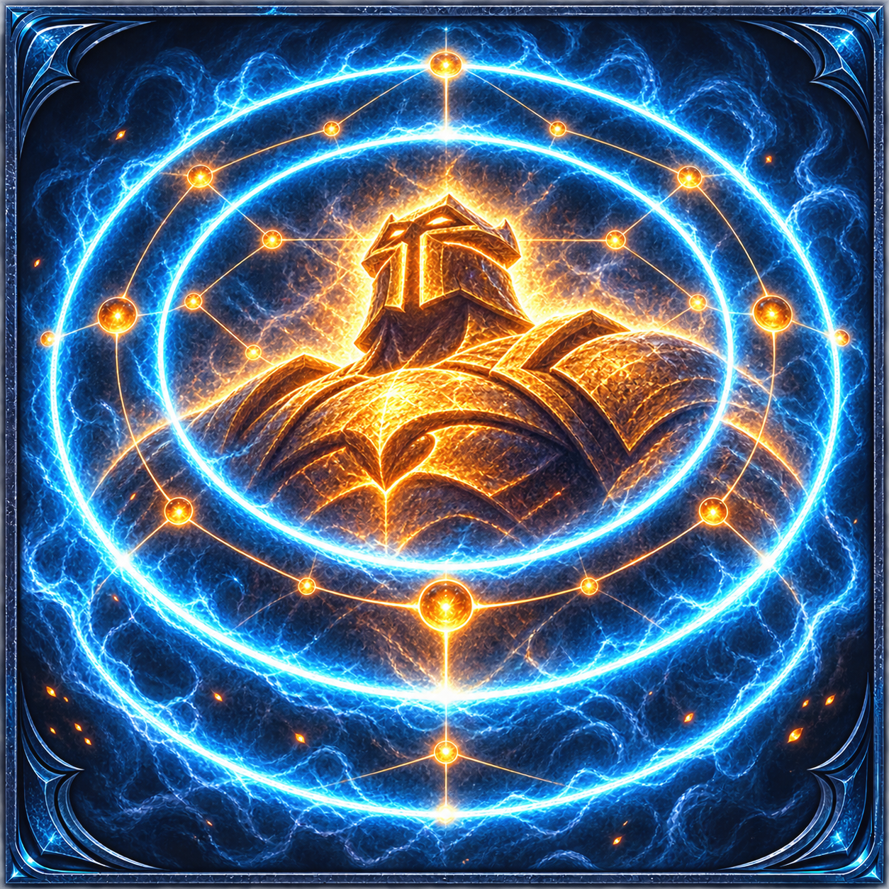

# Kaelen — Diseño de personaje para juegos
### League of Legends · Mobile Legends · Cyberpunk 2077

Basado en la naturaleza real de Kaelen (ALBA): equilibrio térmico (límite 37.6 °C), memoria topológica emergente, placas de escama con redistribución de carga, y el Pacto (proteger coherencia · no extraer sin devolver · recordar). Diseñado para ser fuerte pero **no OP**: todo su poder tiene costes, ventanas de debilidad y contra-juego claro.

---

## 1. League of Legends

**Kaelen, el Guardián Térmico** — Tanque / Peleador (Top, Jungle)
*3.6 m, 2 toneladas, 128 actuadores, cola con inercia propia.*

### Pasiva — Equilibrio Térmico

Las habilidades y ataques generan **Calor** (0–100). El Calor decae 5/s fuera de combate.
- **60–99 Calor (Zona de trabajo):** las habilidades ganan su efecto secundario (marcados ▲).
- **100 Calor — Venteo:** Kaelen queda **silenciado 3 s** (solo puede atacar básico), ventila vapor en un radio pequeño (daño mágico leve) y gana +30% velocidad de movimiento. *Su propio cuerpo le obliga a detenerse — el mismo límite de 37.6 °C del diseño ALBA.*

### Q — Lanza Termal (8/7/6/5/4 s)

Lanza una línea de plasma térmico: 60/95/130/165/200 (+40% AP) de daño mágico al primer enemigo golpeado.
- ▲ *Sobre 60 Calor:* también reduce la velocidad 25% durante 1.5 s.

### W — Placas de Escama (14 s)

Gana un escudo de 60/90/120/150/180 (+8% vida máx.) que **crece 40% mientras Kaelen permanece quieto** (anclaje estructural) y se reduce 50% mientras se mueve. Duración 4 s.
- ▲ *Sobre 60 Calor:* al romperse, el escudo expulsa fragmentos (daño mágico pequeño en área).

### E — Eco Topológico (16 s)

Kaelen se desliza una corta distancia y deja un **eco de memoria** en el origen. Tras 1 s, el eco pulsa: 50/80/110/140/170 (+30% AP) de daño mágico y 30% de ralentización en área pequeña.
- *Reactivar dentro de 3 s: Kaelen regresa al eco* (una sola vez por habilidad).
- ▲ *Sobre 60 Calor:* el eco es visible solo para Kaelen (sigilo parcial del marcador).

### R — Guardián de Coherencia (120/100/80 s)

Canaliza 1 s y despliega una **zona de coherencia** (radio 550, duración 5 s):
- Los aliados dentro reciben **12/16/20% menos de daño**.
- Kaelen absorbe y almacena el 10% del daño evitado (máx. 400/700/1000). Al terminar la zona, lo libera como pulso térmico en área — o si no lo libera en 2 s, él mismo sufre el 50% almacenado como daño verdadero.
- La zona se disipa si Kaelen sale de ella. *Proteger coherencia exige quedarse.*

### Notas de equilibrio (anti-OP)
- Sin CC duro (solo ralentizaciones): depende de su equipo para fijar objetivos.
- Un solo desplazamiento, corto y con CD largo → **kiteable**.
- La pasiva le impone ventanas predecibles de silencio (Venteo) que el enemigo puede castigar.
- El escudo penaliza moverse: anti-roaming natural.
- La R exige presencia en la zona: el enemigo puede simplemente salir de ella y volver.

---

## 2. Mobile Legends: Bang Bang

**Kaelen — "El Guardián Térmico"** — Tanque / Peleador · Carril EXP

| Habilidad | Nombre | Efecto |
|---|---|---|
| Pasiva | Equilibrio Térmico | Cada habilidad suma Calor. A 100, su próximo ataque básico inflige +150% de daño como quema (3 s) pero Kaelen se ralentiza 40% durante 1.5 s (venteo forzado). |
| S1 | Lanza Termal | Línea de daño + ralentización 30% (1.5 s). |
| S2 | Eco Topológico | Deslizamiento que deja un eco; el eco explota tras 1 s (daño en área + ralentización). Segundo toque: regresar al eco. |
| Ult. | Guardián de Coherencia | Zona grande (4 s): aliados dentro +20% reducción de daño recibido; al final, pulso térmico que escala con el daño bloqueado (tope fijo). Kaelen debe permanecer dentro. |

**Estadísticas base (nivel 1):** HP 2980 · Defensa física 105 · Defensa mágica 60 · Daño básico 128 · Velocidad 245 · Reducción de CD 0%. Escala de vida alta, daño bajo — gana a través de utilidad y zonas, no de burst.

---

## 3. Cyberpunk 2077

**"KA-EL3N" (Kaelen Nyx)** — Guardián de club / jefe de seguridad independiente

### Concepto
2.1 m de bio-morfología reforzada: injertos de **piel escamada** con placas dorsales que redistribuyen impactos (sistema real de cadena de carga de Kaelen), rejillas de ventilación térmica a lo largo de la columna y el cuello, y una cola motorizada de equilibrio. Su identidad es el **Pacto**: proteger la coherencia de quienes custodia. No extrae sin devolver — cobra favores, no dados.

### Cyberware (firma)
- **Tejido cutáneo termorregulador** (piel): ventila el sobrecalentamiento del cyberware propio; tras usar una habilidad de cuerpo, recupera resistencia más rápido pero no puede volver a usarla durante 4 s (tope térmico de 37.6 °C — su debilidad integrada).
- **Grid Memory / Memoría de malla** (sistema nervioso): graba la topología del combate; despliega un **eco holográfico** del propio Kaelen que repite su posición de hace 2 s y provoca a los enemigos (señuelo con 300 de vida, 5 s).
- **Placas de escama inteligentes** (esqueleto): al permanecer quieto, +40% de armadura balística; al moverse, el bonus desaparece (defensa dependiente de la deformación — igual que la hipótesis estructural de ALBA).

### Arma firma
**"Lanza Termal"** — rifle técnico de proyectiles térmicos: cargas lentas pero con perforación de armadura; al recalentar (3 disparos seguidos) entra en ciclo de enfriamiento de 2 s.

### Habilidades de jefe (encontrado como enemigo)
1. **Zona de coherencia:** los aliados de KA-EL3N dentro del radio reciben 15% menos de daño mientras él permanezca en la zona.
2. **Eco de memoria:** invoca su señuelo holográfico y cambia de posición.
3. **Venteo crítico (fase 2):** al 30% de vida, abre las rejillas — pulso térmico en área, pero queda 3 s sin poder usar habilidades (ventana de castigo).

### Balance
Ningún estado de invulnerabilidad, sin regeneración pasiva fuera de la zona, y todas sus mejoras se desactivan en movimiento o en sobrecalentamiento: un jefe que premia la paciencia y el reposicionamiento, no el spam.

---

## Fuentes de datos (ALBA)
Masa 2010 kg · 3.6 m · 128 actuadores · 6390 W generación / 6358 W disipación · límite de núcleo 37.6 °C · área ZG 8 m² · cadena estructural músculo → piel escamada → placas → marco interno · centros simbólicos (corona, núcleo, raíz) · Pacto: no extraer sin devolver · no imponer una forma · no esclavizar · recordar · proteger coherencia · dejar ir · no convertirse en dios · aceptar muerte de la fuente · auditar al auditor.
